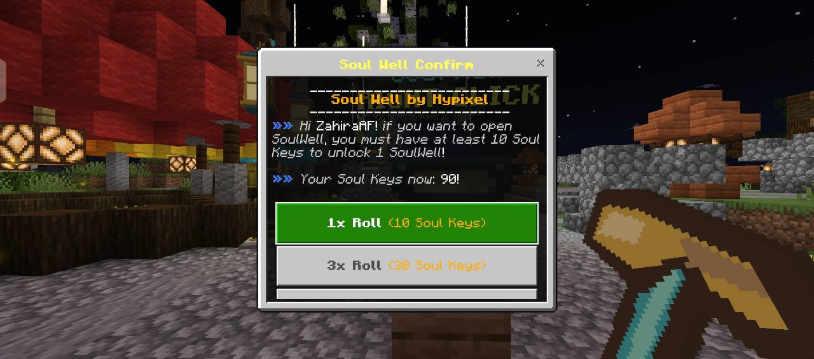
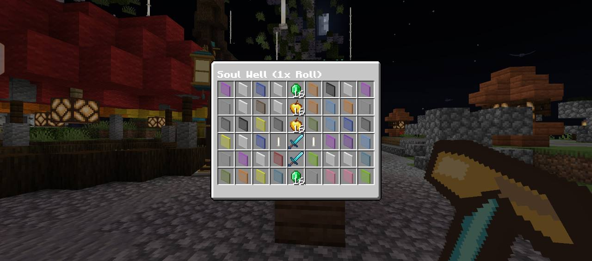
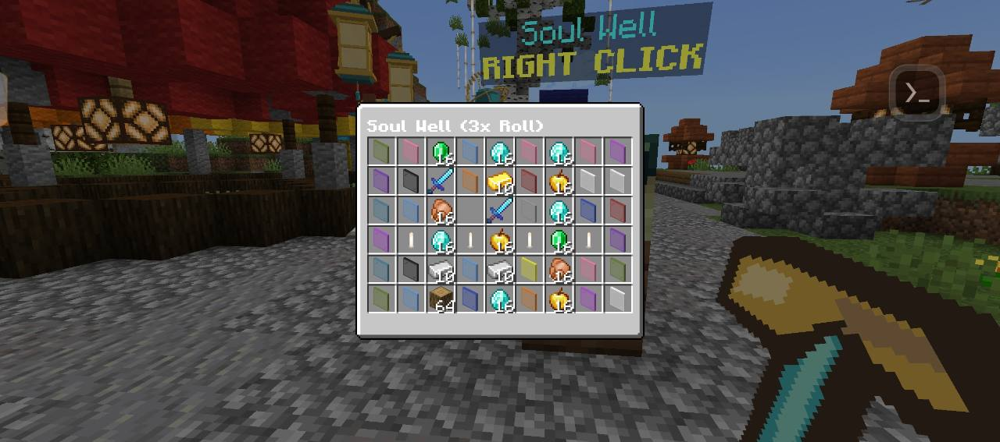
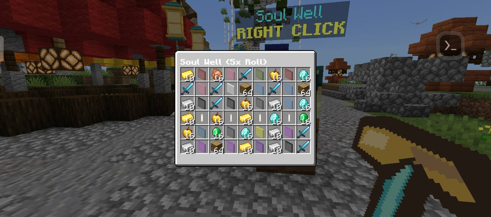

<h1 align="center">🔮 SoulWell 🔮</h1>

  <b>Lucky Draw Plugin inspired by Hypixel's Soul Well</b> 
  <i>Development Version: <b>v1.7.0</b> | Supports PMMP API 5.27.0+</i>

<table> <tr> <td></td> <td></td> <td></td> </tr> </table>

---

## 📥 Download

[**Download Latest .phar (v1.6.5)**](https://github.com/ZulfahmiFjr/SoulWell/releases/download/v1.6.5/SoulWell_v1.6.5.phar)  
Compatible with **PocketMine-MP API 5.0.0 - 5.27.0+**

---

## 🧿 Features

- **Hypixel Soul Well Experience**: Authentic lucky draw roulette inspired by Hypixel's SkyWars Soul Well.
- **Multi-Roll System**: Open **1x Roll** (10 Keys), **3x Roll** (30 Keys), or **5x Roll** (50 Keys) at once in multi-column chest displays.
- **Smooth Deceleration Physics**: Roulette spins start ultra-fast (1-tick rate) and progressively decelerate across smooth timing curves before landing on the winning center row.
- **Dynamic Audio Feedback**: Realistic Note Block tick sounds with rising pitch during deceleration, followed by a triumphant level-up chime upon reward delivery.
- **Anti-Loss & Auto-Refund**: Comprehensive session protection that automatically refunds Soul Keys if a roll is interrupted, window-closed, or disconnected before starting.
- **Mobile-Friendly & Case-Insensitive**: Supports `/sw`, `/soulwell`, `/SoulWell`, and `/SOULWELL` without unknown command errors on mobile keyboards.
- **Unified Command System**: Simplified `/sw` hub command (`/sw create`, `/sw key`, `/sw info`).
- **Soul Keys Currency**: Configurable per-player key balance stored securely.
- **Customizable Loot Table**: Add custom items, amounts, custom names, lore, and enchantments in `config.yml`.
- **ScoreHud Integration**: Built-in `{soulwell.soulkey}` score tag to show player key counts on scoreboards.
- **Nautic SoulWell JSON UI**: Navy panels, cyan button states, gold reward markers, and a compact confirmation menu with all three roll choices visible without scrolling (`classic-chest-rp: true`).
- **SoulWell-Only Inventory Design**: Dedicated vertical 1x, 3x, and 5x reward reels use actual container items and stack counts. Regular chests and unrelated forms keep their existing layouts.
- **Resource Pack Compatibility**: The pack is rebuilt automatically on startup, preserving the existing form dispatcher and shared UI definitions from other server packs.

The `dev` branch contains the v1.7.0 UI update. The published download above remains v1.6.5 until a new release is published. After a UI pack update, reconnect to the server to load the new pack. See [UI integration notes](docs/SOULWELL-UI.md) for build instructions and validation limits.

---

## 📸 In-Game Screenshots

These screenshots show the previous v1.6.5 interface and are retained as a record of the working roll system.

<table align="center">
  <tr>
    <td align="center"><b>Multi-Roll Selection Menu</b></td>
    <td align="center"><b>1x Roll GUI</b></td>
  </tr>
  <tr>
    <td></td>
    <td></td>
  </tr>
  <tr>
    <td align="center"><b>3x Multi-Roll GUI</b></td>
    <td align="center"><b>5x Multi-Roll GUI</b></td>
  </tr>
  <tr>
    <td></td>
    <td></td>
  </tr>
</table>

---

## ▶️ Demo Videos

Check out SoulWell in action on YouTube:

- [SoulWell Preview by ZulfahmiFjr](https://www.youtube.com/watch?v=4cFAz_Sn1Eo)
- [SoulWell Preview by AmlxP Modz シ](https://www.youtube.com/watch?v=JBJBAauGoG4)
- [SoulWell Preview by FIO](https://www.youtube.com/watch?v=BdTHKTVP434)
- [SoulWell Preview by Fredy Ma'ruf](https://www.youtube.com/watch?v=R4vB_SDOgz0)
- [SoulWell Preview by Yusril 9F](https://www.youtube.com/watch?v=x550VlR_Q5s)
- [SoulWell Preview by ModdingTwinzツ](https://www.youtube.com/watch?v=2OWY2O6lcms)

---

## 🧾 How to Use

1. Run `/sw create` and break 1 block to place the SoulWell altar (admin only).
2. Right-click or tap the SoulWell block to open the menu.
3. Select your desired roll mode:
   - **1x Roll** (10 Soul Keys)
   - **3x Roll** (30 Soul Keys)
   - **5x Roll** (50 Soul Keys)
4. Watch the animated roulette spin down smoothly and claim your random loot!
5. Admins can give Soul Keys to players anytime using `/sw key [player-name] [count]`.

---

## 💻 Commands & Permissions

| Command | Description | Permission |
| :--- | :--- | :--- |
| `/sw` or `/soulwell` | View available SoulWell subcommands | `soulwell.command` (default: true) |
| `/sw info` | Show plugin information & author contacts | `soulwell.command` (default: true) |
| `/sw create` | Place a new SoulWell altar block | Operator only |
| `/sw key <player> <amount>` | Add Soul Keys to a player | Operator only |

---

## 📸 Classic Altar Preview

  
   <i>SoulWell block design with floating label!</i>

--- 
Maintained by [ZulfahmiFjr](https://github.com/ZulfahmiFjr)
