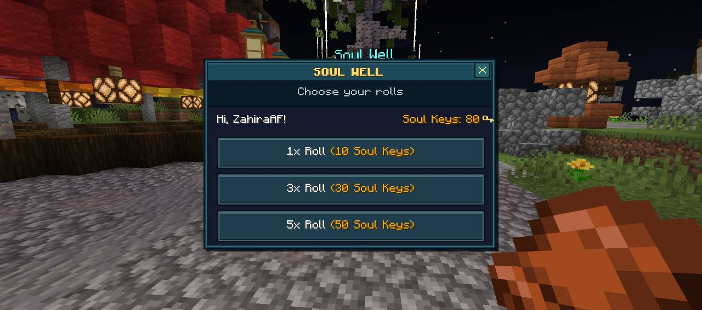
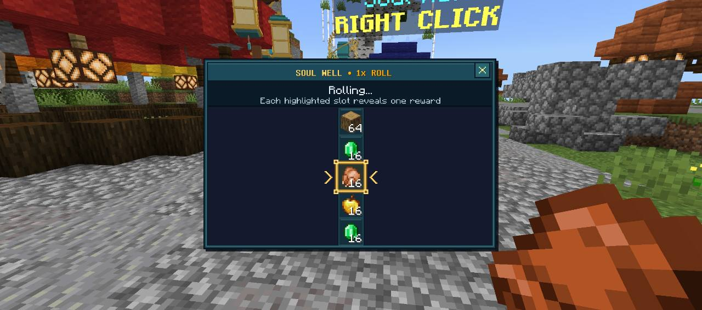
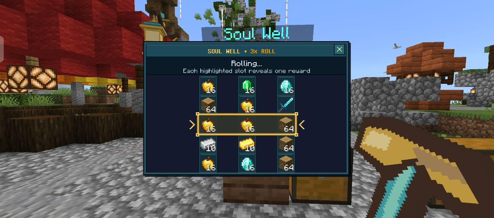
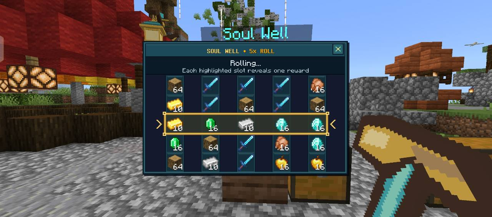
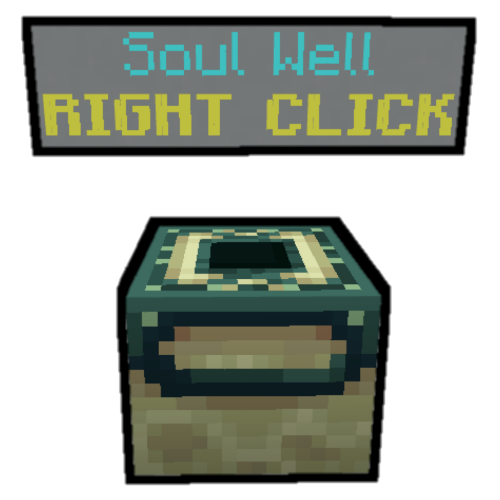

<h1 align="center">🔮 SoulWell 🔮</h1>

<p align="center">
  <b>Lucky Draw Plugin inspired by Hypixel's Soul Well</b><br>
  <i>Development Version: <b>v1.9.5</b> | Supports PMMP API 5.27.0+</i>
</p>


---

## 📥 Download

[**Download Latest .phar (v1.6.5)**](https://github.com/ZulfahmiFjr/SoulWell/releases/download/v1.6.5/SoulWell_v1.6.5.phar)  
Compatible with **PocketMine-MP API 5.0.0 - 5.27.0+**

---

## 🧿 Features

- **Hypixel Soul Well Experience**: Authentic lucky draw roulette inspired by Hypixel's SkyWars Soul Well.
- **Multi-Roll System**: Open **1x Roll** (10 Keys), **3x Roll** (30 Keys), or **5x Roll** (50 Keys) at once in multi-column chest displays.
- **Smooth Deceleration Physics**: Roulette spins start ultra-fast (1-tick rate) and progressively decelerate across smooth timing curves before landing on the winning center row.
- **Dynamic Audio Feedback**: Realistic Note Block tick sounds with rising pitch during deceleration, followed by a triumphant level-up chime upon reward delivery.
- **Anti-Loss & Auto-Refund**: Comprehensive session protection that automatically refunds Soul Keys if a roll is interrupted, window-closed, or disconnected before starting.
- **Mobile-Friendly & Case-Insensitive**: Supports `/sw`, `/soulwell`, `/SoulWell`, and `/SOULWELL` without unknown command errors on mobile keyboards.
- **Unified Command System**: Simplified `/sw` hub command (`/sw create`, `/sw key`, `/sw info`).
- **Soul Keys Currency**: Configurable per-player key balance stored securely.
- **Customizable Loot Table**: Add custom items, amounts, custom names, lore, and enchantments in `config.yml`.
- **Reward Rarities**: Common, Rare, Epic, and Legendary rewards have configurable tier percentages and relative item weights. Rarity colors appear in item lore and reward messages.
- **Rare Win Celebrations**: Epic and Legendary wins are announced server-wide. The winner receives a colored title, Totem of Undying sound, and level-up chime. Multi-roll sessions show one title and celebration sound for the highest rarity won.
- **Expanded Nautic Loot**: 21 default rewards, including 13 new entries with custom enchanted swords, axes, bows, pickaxes, and armor.
- **Safe Config Upgrade**: Existing reward fields and server settings are preserved, new rewards are appended once, and the previous configuration is backed up before migration.
- **Prize List & Details**: Browse Common, Rare, Epic, and Legendary prizes in a custom two-column JSON UI. Select an item to see its per-roll chance, quantity, type, enchantments, and lore directly from the configured loot table.
- **ScoreHud Integration**: Built-in `{soulwell.soulkey}` score tag to show player key counts on scoreboards.
- **Nautic SoulWell JSON UI**: Stone-gray headers, sage borders, green button states, gold reward markers, and a compact confirmation menu with all three roll choices visible without scrolling (`classic-chest-rp: true`).
- **SoulWell-Only Inventory Design**: Dedicated vertical 1x, 3x, and 5x reward reels use actual container items and stack counts. Regular chests and unrelated forms keep their existing layouts.
- **Resource Pack Compatibility**: The pack is rebuilt automatically on startup, preserving the existing form dispatcher and shared UI definitions from other server packs.

The `dev` branch contains v1.9.5, recoloring the existing panels and buttons with the stone-gray and sage palette of Pets Sanctuary. The Prize List, Prize Details, weighted rarities, and win celebrations retain their existing layout and text. The confirmation menu now includes a Prize List button, a bordered footer, and the stone-gray, sage, green, and gold styling used throughout the browser. The interface retains login pack priority and marker-based container routing. A separate visibility wrapper keeps existing server form dispatchers hidden while SoulWell is open, and close buttons are inset within every SoulWell panel header. Both classic and data-driven container screens recognize SoulWell roll menus. The published download above remains v1.6.5 until a new release is published. Reconnect to the server after the UI pack update to download version 1.9.5.

---

## 📸 In-Game Screenshots

### Nautic SoulWell JSON UI

The screenshots below show the v1.7.5 confirmation menu and all three roll modes verified in Minecraft Bedrock, with navy-and-cyan panels and gold selection markers. The v1.9.0 Prize List and expanded confirmation layout are described below; these existing screenshots are retained until updated client captures are available.

<table align="center">
  <tr>
    <td align="center"><b>Roll Selection Menu</b></td>
    <td align="center"><b>1x Roll</b></td>
  </tr>
  <tr>
    <td></td>
    <td></td>
  </tr>
  <tr>
    <td align="center"><b>3x Roll</b></td>
    <td align="center"><b>5x Roll</b></td>
  </tr>
  <tr>
    <td></td>
    <td></td>
  </tr>
</table>

---

## ▶️ Demo Videos

Check out SoulWell in action on YouTube:

- [SoulWell Preview by ZulfahmiFjr](https://www.youtube.com/watch?v=4cFAz_Sn1Eo)
- [SoulWell Preview by AmlxP Modz シ](https://www.youtube.com/watch?v=JBJBAauGoG4)
- [SoulWell Preview by FIO](https://www.youtube.com/watch?v=BdTHKTVP434)
- [SoulWell Preview by Fredy Ma'ruf](https://www.youtube.com/watch?v=R4vB_SDOgz0)
- [SoulWell Preview by Yusril 9F](https://www.youtube.com/watch?v=x550VlR_Q5s)
- [SoulWell Preview by ModdingTwinzツ](https://www.youtube.com/watch?v=2OWY2O6lcms)

---

## 🧾 How to Use

1. Run `/sw create` and break 1 block to place the SoulWell altar (admin only).
2. Right-click or tap the SoulWell block to open the menu.
3. Select your desired roll mode:
   - **1x Roll** (10 Soul Keys)
   - **3x Roll** (30 Soul Keys)
   - **5x Roll** (50 Soul Keys)
4. Watch the animated roulette spin down smoothly and claim your random loot!
5. Admins can give Soul Keys to players anytime using `/sw key [player-name] [count]`.
6. Select **Prize List** to browse rewards without spending keys. Switch rarity tabs, then select an item to open its details. **Back to Prize List** returns to the selected rarity, and **Back** returns to the roll menu.

---

## Reward Rarities & Configuration

Edit `plugin_data/SoulWell/config.yml` and restart the server to apply loot changes. Each reel independently selects a rarity first, then an item within that rarity. The default tier chances are:

| Rarity | Color | Drop Chance | Default Items | Celebration |
| :--- | :--- | ---: | ---: | :--- |
| Common | White | 60% | 6 | Personal reward message and level-up chime |
| Rare | Cyan | 25% | 6 | Personal reward message and level-up chime |
| Epic | Purple | 12% | 5 | Server broadcast, Epic title, Totem sound, and level-up chime |
| Legendary | Gold | 3% | 4 | Server broadcast, Legendary title, Totem sound, and level-up chime |

```yaml
rarities:
    common: 60
    rare: 25
    epic: 12
    legendary: 3
celebration:
    broadcast: true
    title: true
    sound: true
    message: "§f§lSoulWell§r§f: §r§f{PLAYER} §7§ojust found §r{COLOR}[{RARITY} {ITEM}§r{COLOR}] §7§oin SoulWell§r§f!"
```

Tier percentages must total exactly **100**, with up to two decimal places. A tier set to `0` is disabled. Every tier with a positive chance must contain at least one valid reward. Invalid loot configuration disables rolling before any Soul Keys are charged and prints an explanation in the console.

Each reward accepts `rarity` and `weight`. A weight of `2` makes that item twice as likely as an item with weight `1` in the same tier. An item's final chance is **tier chance × item weight ÷ total weight in that tier**. For example, the four default Legendary items each have a **0.75%** chance per reel. Adding more items to a tier does not increase that tier's overall drop rate.

The Prize List opens on the Legendary tab and displays item icons, names, quantities, and rarity badges in two columns. Longer lists scroll inside the panel while the tabs and Back button remain visible. The details panel highlights the selected item's actual chance per roll on the left and shows its item type, enchantment levels, and lore on the right. Long descriptions scroll independently. Browsing is read-only and does not debit Soul Keys or give items.

The browser and roll selection share the same compiled reward table. Updating weights or adding/removing rewards in `config.yml` and restarting rebuilds the browser accordingly. Percentages are rounded to two decimal places; positive chances below `0.01%` display as `<0.01%`. Names that exceed the compact card or heading width are abbreviated, with the full name retained in the details text.

Item icons use the vanilla texture paths indexed from [Mojang's Bedrock samples](https://github.com/Mojang/bedrock-samples/tree/main/resource_pack/textures). Included enchanted icon variants are adapted from the corresponding sample textures for the prize browser. A reward may specify an `icon: "textures/..."` path for a custom resource-pack image. Items without a known icon use a gift placeholder. The JSON UI can be rebuilt with `python3 tools/build-ui.py`; rebuilding the enchanted icon variants uses `python3 tools/build-prize-icons.py` with Pillow installed.

Example Legendary entry within the existing `items` list:

```yaml
   - key: nautilus_fang
     name: "§6§lNautilus Fang§r"
     id: "netherite_sword"
     amount: 1
     rarity: legendary
     weight: 1
     lore: "§7The legendary blade of Nautic Craft"
     enchantments:
       sharpness:
        level: 5
       fire_aspect:
        level: 2
       unbreaking:
        level: 3
```

New loot includes Reef Blade, Reef Miner, Sea Hunter, Tidebreaker, Coral Cleaver, Ocean Guard, Deepsea Drill, Nautilus Fang, Abyssal Reaver, Poseidon Drill, and Leviathan Guard, plus bread and arrows. Custom equipment uses vanilla item types, custom names, lore, and enchantments supported by Altay.

Only Epic and Legendary rewards trigger broadcasts. The message supports `{PLAYER}`, `{ITEM}`, `{RARITY}`, `{COLOR}`, and `{AMOUNT}`. A 3x or 5x roll announces each Epic/Legendary reward separately, while the winner sees one title for the highest rarity. Celebration audio is sent only to the winner. Broadcasts, titles, and sounds can each be disabled independently.

On the first upgrade to configuration version `2`, SoulWell saves an exact `config.yml.before-rarity-*` backup, assigns tiers to existing rewards, and appends the 13 new entries without changing existing item properties. Unknown legacy item types default to Common. Subsequent restarts keep the edited loot list as configured. Closing a started roll settles its preselected rewards once; disconnecting or shutting down an unsettled roll refunds its keys.

The reward checks run against the installed Altay item, enchantment, sound, and inventory classes without launching another server or touching live player data:

```sh
php tools/check-rewards.php /path/to/altay/vendor/autoload.php
python3 tools/check-ui.py
```

The PHP check includes `tools/check-rolls.php` and `tools/check-prizes.php` to verify rarity boundaries, item weights, configuration migration, 1x/3x/5x outcomes, interrupted-roll refunds, celebrations, prize navigation, displayed chances, and duplicate or invalid form responses. Menu navigation uses Altay's native form registration and validation.

---

## 💻 Commands & Permissions

| Command | Description | Permission |
| :--- | :--- | :--- |
| `/sw` or `/soulwell` | View available SoulWell subcommands | `soulwell.command` (default: true) |
| `/sw info` | Show plugin information & author contacts | `soulwell.command` (default: true) |
| `/sw create` | Place a new SoulWell altar block | Operator only |
| `/sw key <player> <amount>` | Add Soul Keys to a player | Operator only |

---

## 📸 Classic Altar Preview

<p align="center">
  
  <br><i>SoulWell block design with floating label!</i>
</p>

--- 
Maintained by [ZulfahmiFjr](https://github.com/ZulfahmiFjr)
